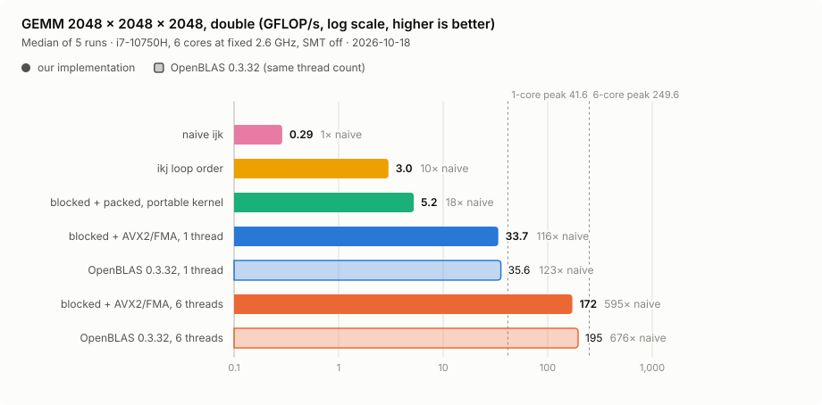
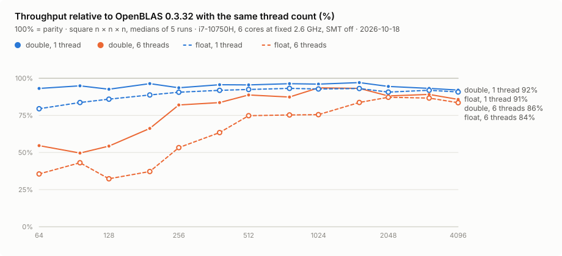

# Linear Algebra Library

A numerical linear algebra library in modern C++. The project is designed to
demonstrate ownership-aware C++ design, numerical reasoning, benchmarking, profiling, cache-aware
optimization, SIMD, and concurrency through incremental, measured development.

Matrix multiplication runs on a cache-blocked, packed GEMM with an AVX2/FMA micro-kernel and a
dynamic-scheduling thread pool. Every optimization is measured before it becomes the default.

**Headline (double, 2048 x 2048 x 2048, i7-10750H at a fixed 2.6 GHz):** 33.7 GFLOP/s on one core
(81% of peak, 94% of OpenBLAS), 172 GFLOP/s on six cores (5.1x, 88% of OpenBLAS), 116x faster than
a naive `ijk` loop, with results bitwise identical for any thread count.

## Performance

Controlled run on 2026-10-18: Intel i7-10750H, 6 cores at a fixed 2.6 GHz (turbo off), SMT off,
GCC 15.2, OpenBLAS 0.3.32 as the baseline, median of 5 repetitions. Peak is 41.6 GFLOP/s per core in
double (16 FLOP/cycle x 2.6 GHz).

<picture>
  <source media="(prefers-color-scheme: dark)" srcset="docs/images/gemm-ladder-2048-dark.svg">
  
</picture>

| double, 2048^3 | GFLOP/s | % of peak | vs naive `ijk` | vs OpenBLAS |
|---|---:|---:|---:|---:|
| naive `ijk` | 0.29 | 0.7% | 1x | |
| `ikj` loop order | 3.00 | 7.2% | 10x | |
| blocked + packed, portable kernel | 5.23 | 12.6% | 18x | |
| **blocked + AVX2/FMA, 1 thread** | **33.7** | **80.9%** | **116x** | **94%** |
| **blocked + AVX2/FMA, 6 threads** | **172.1** | **68.9%** | **595x** | **88%** |

<picture>
  <source media="(prefers-color-scheme: dark)" srcset="docs/images/gemm-vs-openblas-dark.svg">
  
</picture>

What each step contributes, measured with `perf stat` at 1024^3:

- **loop order** (`ijk` -> `ikj`): no more column walks over B; cycles stalled on L2 misses fall
  from 42% to 8%;
- **cache blocking and packing:** memory stalls fall to 1.9%, but a scalar SSE2 kernel stays at
  2 FLOP/cycle;
- **AVX2/FMA micro-kernel:** the same data flow at 12.9 FLOP/cycle, 81% of peak;
- **six threads with dynamic chunks:** 5.1x (85% parallel efficiency at 1024-2048^3); dynamic
  scheduling recovered 12-20% over a static split, and prefetching the packed panels across page
  boundaries another 5-17%.

The [performance documentation](docs/performance.md) has the size sweep from 64^3 to 4096^3, float
results, thread scaling, hardware counters, each experiment's method and A/B data, and the
limitations. The earlier scalar loop-order experiment is kept there as
[Experiment 4](docs/performance.md#experiment-4----scalar-matmul-loop-ordering).

## How the GEMM works

`DynamicMatrix` multiplication calls `internal::gemm` ([src/gemm.cpp](src/gemm.cpp)), a
GotoBLAS/BLIS-style implementation:

- **cache blocking and packing:** five loops sized to the cache levels (packed B panel in L3,
  packed A block in each core's L2, B micro-panel in L1); packing makes every kernel read sequential
  and aligned, and zero-pads edges;
- **AVX2/FMA micro-kernel:** a 6 x 8 (double) or 6 x 16 (float) tile held in 12 `ymm`
  accumulators, software prefetch of the packed panels and the C tile; enabled per function with
  `[[gnu::target("avx2,fma")]]` and selected with a runtime CPU check, so the library still runs on
  any x86-64 (and elsewhere with the portable kernel);
- **threads:** a persistent `std::jthread` pool; each `pc` step is split into chunks taken from an
  atomic counter, so a slow or preempted thread does fewer chunks instead of stalling the others.
  The k dimension is never split, so results are bitwise identical for any thread count. One
  thread is used below 2 x 128^3 FLOP, where waking the pool costs more than it saves; the default
  otherwise is the number of physical cores the process may use.

Static matrices keep a `constexpr` `ikj` kernel: constant evaluation rules out intrinsics, heap
buffers, and threads, and small fixed shapes do not repay packing.

## Features

- **Containers:** owning `DynamicMatrix<T>` and `DynamicVector<T>` (aliases `Matrix` and `Vector`
  for `double`) and fixed-size `StaticMatrix<T, Rows, Cols>` and `StaticVector<T, Size>` stored
  inline in a `std::array` and usable in `constexpr`; `T` is `float` or `double`.
- **Access:** contiguous row-major `data()`, unchecked `operator()` / `operator[]` (asserted in
  Debug builds), and checked `at()` that throws `std::out_of_range`.
- **Arithmetic:** in-place and value-returning addition, subtraction, and scalar arithmetic for the
  dynamic types.
- **Linear algebra:** transpose, matrix-vector and matrix-matrix multiplication, trace, L1/L2/infinity
  vector norms, one/Frobenius/infinity matrix norms, L2 normalization, and adding a vector to every
  row or column.
- **Checked shapes:** runtime dimension mismatches throw `std::invalid_argument`; incompatible static
  shapes do not compile.

Trace, norms, normalization, and broadcasting still take the double-precision aliases, and static
matrices have no elementwise arithmetic yet. The [API reference](docs/api.md) lists every
constructor, initialization rule, and error case.

## Quick start

```cpp
#include <linalg/linalg.hpp>

int main() {
    linalg::Matrix matrix{{1.0, 2.0, 3.0},
                          {4.0, 5.0, 6.0}};
    const linalg::Vector row_values{10.0, 20.0, 30.0};

    const linalg::Matrix adjusted =
        linalg::add_to_each_row(matrix, row_values);
    const linalg::Matrix transposed = linalg::transpose(matrix);

    const double matrix_size =
        linalg::norm(matrix, linalg::MatrixNorm::frobenius);

    linalg::Vector vector{1.0, 2.0, 3.0};
    const linalg::Vector other{4.0, 5.0, 6.0};

    vector += other;
    vector -= 1.0;
    vector *= 2.0;

    const double vector_length =
        linalg::norm(vector, linalg::VectorNorm::l2);

    return adjusted.at(0, 0) == 11.0 &&
                   transposed.at(0, 1) == 4.0 &&
                   matrix_size > 0.0 && vector_length > 0.0
               ? 0
               : 1;
}
```

Fixed-size matrices and vectors work at compile time:

```cpp
constexpr linalg::StaticMatrix<double, 2, 3> fixed{{1.0, 2.0, 3.0}, {4.0, 5.0, 6.0}};
constexpr linalg::StaticVector<double, 3> vector{7.0, 8.0, 9.0};
constexpr auto transposed = linalg::transpose(fixed); // StaticMatrix<double, 3, 2>
constexpr auto applied = linalg::multiply(fixed, vector); // StaticVector<double, 2>
constexpr auto product = linalg::multiply(fixed, transposed); // StaticMatrix<double, 2, 2>
static_assert(applied[0] == 50.0 && product(0, 0) == 14.0);
```

## Build and test

Requirements:

- CMake 3.20 or newer
- A C++20 compiler such as GCC or Clang
- Git and network access when GoogleTest or Google Benchmark are not installed locally
- Optional: OpenBLAS (`libopenblas-dev` on Ubuntu) to add BLAS baselines to the GEMM benchmarks
- Optional: Python 3 (standard library only) to redraw the performance charts

GoogleTest 1.17.0 and Google Benchmark 1.9.5 are development-only dependencies. CMake first looks
for installed packages and otherwise fetches the pinned releases. OpenBLAS is found through
`pkg-config` and used only by the benchmarks (`-DLINALG_BENCHMARK_OPENBLAS=OFF` disables it).

```bash
cmake --preset debug
cmake --build --preset debug
ctest --preset debug --output-on-failure
```

AddressSanitizer with UndefinedBehaviorSanitizer, and ThreadSanitizer (which cannot be combined
with AddressSanitizer) have their own presets:

```bash
cmake --preset sanitized && cmake --build --preset sanitized && ctest --preset sanitized
cmake --preset tsan && cmake --build --preset tsan && ctest --preset tsan
```

## Benchmarks

```bash
cmake --preset release
cmake --build --preset release
ctest --preset release --output-on-failure
./build/release/benchmarks/linalg_benchmarks --benchmark_list_tests
```

Compare every GEMM optimization step and OpenBLAS at one size (`_f64` or `_f32`; OpenBLAS
families appear when it is installed):

```bash
./build/release/benchmarks/linalg_benchmarks \
    --benchmark_filter='^BM_Gemm(ScalarIkj|BlockedAvx2|BlockedAvx2Mt)_f64/1024/' \
    --benchmark_repetitions=5 \
    --benchmark_report_aggregates_only=true
```

Benchmarks are separated by operation family in `benchmarks/`, while one executable and Google
Benchmark's regular-expression filter provide a common runner. `gemm_comparison_benchmark.cpp`
holds the GEMM ladder (naive `ijk`, `ikj`, blocked portable, blocked AVX2 on one and all cores,
OpenBLAS); `multiply_benchmark.cpp` holds the six scalar loop orders and thread scaling. Kernel-only
timings use a preallocated result, while end-to-end timings also include result allocation and
destruction. Multithreaded benchmarks report wall-clock time.

Publishable numbers come from [tools/run_benchmarks.sh](tools/run_benchmarks.sh). It refuses to
run unless the CPU governor is `performance`, turbo and SMT are off, no CPUs are isolated, and the
machine is idle (or marks the results uncontrolled with `--force`), records the environment, and
writes JSON plus `perf stat` counters to `benchmark-results/`:

```bash
tools/run_benchmarks.sh
python3 tools/plot_gemm_results.py --from-results benchmark-results/<run> --date <YYYY-MM-DD>
```

The second command writes the CSV summaries in `docs/data/` and the light/dark SVG charts in
`docs/images/`.

## Documentation

- [docs/performance.md](docs/performance.md) — every experiment with method, data, charts, and
  limitations
- [docs/api.md](docs/api.md) — containers, construction rules, operations, and error cases

## Repository layout

```text
include/linalg/   Public headers
src/              Library implementation
tests/            GoogleTest correctness tests
benchmarks/       Google Benchmark experiments
examples/         Small API usage programs
cmake/            Project CMake modules
docs/             Performance and API documentation, CSV summaries (docs/data), charts (docs/images)
tools/            Benchmark runner (run_benchmarks.sh) and chart generator (plot_gemm_results.py)
```
