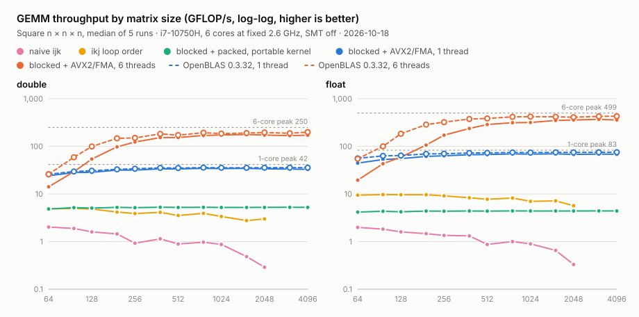
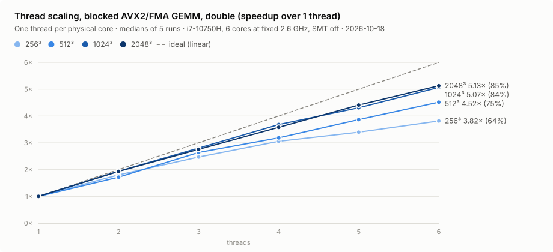
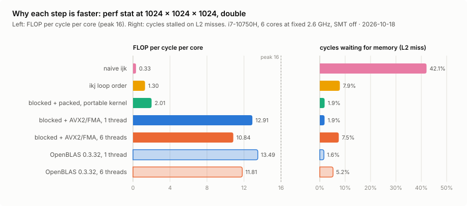

# Performance experiments

## Measurement protocol

For each future experiment, record:

- CPU model, physical/logical core count, and relevant cache sizes;
- operating system and kernel;
- compiler name, version, and optimization/ISA flags;
- build type and exact benchmark command;
- matrix shapes, input-generation method, repetitions, and reported statistic;
- whether allocation, initialization, packing, or thread creation is inside the timed region;
- raw Google Benchmark output and relevant `perf stat` counters;
- hypothesis, change made, result, and interpretation.

Use Release builds for performance measurements. Sanitizer builds are correctness tools and must
not be used for performance comparisons. Prefer native Linux for hardware-counter measurements;
when running under WSL, document counter availability and virtualization limitations.

### Environment

Experiments 1-4 and the 2026-10-10 validation ran in the WSL environment below. Experiments 5-8
and the [controlled run](#controlled-run----2026-10-18) ran on the same laptop booted into native
Ubuntu; that environment is listed with the controlled run.

| Component | Value |
|---|---|
| CPU | Intel Core i7-10750H, 6 cores / 12 logical CPUs |
| L1 data cache | 32 KiB per core, 192 KiB total |
| L2 cache | 256 KiB per core, 1.5 MiB total |
| L3 cache | 12 MiB shared |
| Operating environment | Ubuntu 24.04 under WSL2, Linux 6.18.33.2-microsoft-standard-WSL2 |
| Compiler | GCC 13.3.0 |
| Language/build | C++20, Release, `-O3 -DNDEBUG` |
| Benchmark framework | Google Benchmark 1.9.5 |

WSL scheduling, background activity, CPU frequency changes, and virtualization can add noise. The
tables therefore emphasize medians and coefficients of variation (CV). Differences smaller than
the observed variation are treated as equivalent rather than as wins.

### How to read the tables

- **Median** is the middle repeated-run result and is the primary comparison statistic here.
- **CV** is standard deviation divided by mean; a larger value indicates a noisier measurement.
- **Logical bandwidth** uses the algorithm's logical bytes processed. It is not a measurement of
  physical DRAM traffic because cache-line fills, write allocation, and cache reuse change the
  actual traffic.
- A benchmark iteration is not an independent sample. Repetitions create the run-level samples
  used for mean, median, standard deviation, and CV.

## Experiment 1 -- transpose traversal and access style

### Question

For a row-major matrix transpose, is performance determined primarily by indexed versus pointer
access, or by which side of the copy is traversed contiguously?

### Variants

| Variant | Contiguous side | Inner-loop behavior |
|---|---|---|
| Indexed row-column | Source reads | Destination writes are strided |
| Source-row pointer | Source reads | Destination writes are strided |
| Indexed column-row | Destination writes | Source reads are strided |
| Destination-row pointer | Destination writes | Source reads are strided |

Each kernel uses a preallocated output matrix. Candidate correctness is now checked against an
independent indexed row-column reference before timing. For an `N x N` matrix of doubles, logical
traffic is reported as
`2 x N^2 x sizeof(double)` for one read and one write per element.

### Exploratory traversal comparison

The following 512x512 values came from one calibrated run and are retained as exploratory evidence,
not as final statistics:

| Variant | CPU time | Logical bandwidth | Relative to indexed row-column |
|---|---:|---:|---:|
| Indexed row-column | 726.7 us | 5.38 GiB/s | 1.00x |
| Source-row pointer | 738.0 us | 5.29 GiB/s | 0.98x |
| Indexed column-row | 382.6 us | 10.21 GiB/s | 1.90x |
| Destination-row pointer | 438.1 us | 8.92 GiB/s | 1.66x |

Changing to column-row traversal made output writes contiguous and produced the large improvement.
The pointer rewrite alone did not improve the source-contiguous traversal.

The reason is cache behavior. With row-column traversal, consecutive destination writes are
separated by an entire destination row. For 512 columns of doubles, that stride is 4096 bytes.
Stores repeatedly touch distant cache lines and pages. Column-row traversal instead fills each
destination cache line with adjacent stores, reducing write-allocation and dirty-line pressure.

### Controlled indexed-versus-pointer comparison

Once both implementations used destination-contiguous traversal, they were measured with 15
repetitions and random interleaving:

| Variant | Mean CPU time | Median CPU time | CV | Median logical bandwidth |
|---|---:|---:|---:|---:|
| Indexed column-row | 379.4 us | 377.4 us | 2.24% | 10.35 GiB/s |
| Destination-row pointer | 379.6 us | 376.3 us | 2.51% | 10.38 GiB/s |

The median difference is approximately 0.28%, much smaller than the 2.2-2.5% run variation. GCC's
generated assembly also contained essentially the same hot inner loop for both variants. The
result supports using the clearer indexed implementation: inlining and optimization remove the
abstraction cost, while traversal order controls the important memory behavior.

The shared library transpose now uses destination-contiguous indexed column-row traversal for
both dynamic and static matrices, with `float` and `double` support. The independent row-column
reference remains in the benchmarks; `BM_TransposeLibrary*` measures the selected implementation.
The historical table above is unchanged and is not a measurement of every new instantiation.

## Experiment 2 -- adding a vector to each row

### Question

Does manually walking `data()` improve an already row-major, contiguous operation compared with
inlined `matrix(row, col)` and `vector[col]` access?

The kernel-only comparison mutates a preallocated matrix repeatedly. Both variants traverse matrix
rows and the increment vector contiguously. Results used seven repetitions with random
interleaving.

| Shape | Variant | Mean CPU time | Median CPU time | CV | Median items/s |
|---|---|---:|---:|---:|---:|
| 512x512 | Indexed | 69.5 us | 68.7 us | 2.58% | 3.81 G/s |
| 512x512 | Manual data pointer | 73.9 us | 73.4 us | 6.06% | 3.57 G/s |
| 1024x1024 | Indexed | 461.6 us | 441.6 us | 10.60% | 2.37 G/s |
| 1024x1024 | Manual data pointer | 428.8 us | 422.4 us | 6.35% | 2.48 G/s |

The apparent winner reverses with size: indexed is 6.7% faster by median at 512x512, while the
manual pointer variant is 4.5% faster at 1024x1024. Those differences are comparable to the
observed CV and do not establish a consistent advantage.

Both versions already have the same cache-friendly traversal. After the tiny accessors were moved
into the headers, GCC could reduce indexed expressions to efficient address increments. The current
evidence therefore favors the clearer indexed source until a repeatable improvement is measured.

## Experiment 3 -- trace access style

### Question

Is direct `data()` indexing faster than the inlined `matrix(i, i)` accessor when summing a matrix
diagonal?

Both benchmark candidates are local to the same translation unit so they have equal inlining
opportunities. They perform the same validation and accumulate in `long double`; only the element
access expression differs. A diagonal is not contiguous in row-major storage: consecutive elements
are separated by a stride of `cols + 1`.

Results used nine repetitions with random interleaving:

| Dimension | Variant | Median CPU time | CV | Median logical bandwidth |
|---:|---|---:|---:|---:|
| 64 | Direct data access | 37.5 ns | 13.43% | 12.72 GiB/s |
| 64 | Indexed `operator()` | 36.0 ns | 9.52% | 13.23 GiB/s |
| 512 | Direct data access | 443 ns | 8.40% | 8.61 GiB/s |
| 512 | Indexed `operator()` | 427 ns | 3.67% | 8.93 GiB/s |

Indexed access was approximately 4% faster in these samples, but the difference is smaller than the
observed variation. There is not enough evidence to rewrite the public function. The direct-data
implementation remains the default while more sizes and a quieter measurement environment are
tested.

## Experiment 4 -- scalar matmul loop ordering

### Question

How much does loop ordering affect a scalar row-major matrix multiplication, and does one ordering
remain best for square and rectangular matrices?

### Method

For arguments `M/N/K`, the benchmark multiplies `A(M x K)` by `B(K x N)` into `C(M x N)`. All six
permutations of the `i`, `j`, and `k` loops execute the same update:

```text
C(i, j) += A(i, k) * B(k, j)
```

Each candidate is validated before timing and uses a preallocated result. Clearing `C` is inside
every timed kernel, so allocation is excluded while equal result-initialization work is included.
Inputs are constructed before timing. The full run used a Release build, 0.5 seconds minimum time,
0.2 seconds warmup, 15 repetitions, random interleaving, and aggregate-only reporting:

```bash
./build/release/benchmarks/linalg_benchmarks \
    --benchmark_filter='^BM_MatMul.*Kernel' \
    --benchmark_min_time=0.5s \
    --benchmark_min_warmup_time=0.2 \
    --benchmark_repetitions=15 \
    --benchmark_enable_random_interleaving=true \
    --benchmark_report_aggregates_only=true
```

The measurements were taken on the environment documented above. The medians and CVs were
extracted from console output; the extracted dataset and the Matplotlib tool that drew the two
figures below are no longer in the repository, so these figures are kept as historical images.
Later experiments save Google Benchmark JSON directly with `--benchmark_out`.

### Square scaling


| N | Fastest observed | Median CPU time | Throughput | Slowest observed | Median CPU time | Time ratio |
|---:|---|---:|---:|---|---:|---:|
| 64 | `kij` | 79.0 us | 6.64 GFLOP/s | `jik` | 226.7 us | 2.87x |
| 128 | `ikj` | 626.3 us | 6.70 GFLOP/s | `kji` | 5.758 ms | 9.19x |
| 256 | `ikj` | 5.731 ms | 5.86 GFLOP/s | `kji` | 73.663 ms | 12.85x |
| 512 | `ikj` | 50.433 ms | 5.32 GFLOP/s | `jki` | 622.664 ms | 12.35x |

The table reports observed winners, not proof that one of the two inner-`j` variants is universally
superior. At `N=64`, for example, `kij` was only about 1.1% ahead of `ikj`, while their CPU-time CVs
were 9.52% and 3.40%. The meaningful result is the separation between locality groups:

| Innermost loop | Orders | Row-major access behavior | Observed group |
|---|---|---|---|
| `j` | `ikj`, `kij` | contiguous `B(k,j)` reads and `C(i,j)` updates | fastest |
| `k` | `ijk`, `jik` | contiguous `A(i,k)`, but `B(k,j)` is strided by `N` | middle |
| `i` | `jki`, `kji` | both `A(i,k)` and `C(i,j)` advance with large strides | slowest at larger sizes |

At `N=64`, the three matrices occupy about 96 KiB together and fit within the 256 KiB L2 cache.
At `N=128`, their combined storage is about 384 KiB and no longer fits. The sharp drop of the
inner-`i` variants from roughly 2.3-2.4 GFLOP/s to about 0.73-0.74 GFLOP/s is consistent with cache
locality becoming important, but hardware counters are still needed to establish the precise cause.

### Rectangular shape sensitivity

The next three shapes are permutations of the same dimensions. Consequently, each performs exactly
`2 x M x N x K = 134,217,728` reported FLOPs; only the matrix shapes and traversal behavior change.


| M/N/K | `ikj` | `kij` | Faster observed variant | Throughput ratio |
|---|---:|---:|---|---:|
| 1024/1024/64 | 5.42 GFLOP/s | 2.39 GFLOP/s | `ikj` | 2.27x |
| 1024/64/1024 | 6.07 GFLOP/s | 3.12 GFLOP/s | `ikj` | 1.95x |
| 64/1024/1024 | 3.47 GFLOP/s | 5.67 GFLOP/s | `kij` | 1.63x |

Both variants have contiguous inner `j` loops, yet exchanging the outer `i` and `k` loops reverses
the winner when `M` becomes small. One plausible explanation is reuse: `ikj` keeps one output row
active while sweeping `k`, whereas `kij` keeps one row of `B` active while visiting every output
row. With `M=64`, reusing a `B` row across the small number of output rows appears more favorable;
with `M=1024`, repeatedly walking the much larger set of output rows appears more costly. This is an
inference from timing, not a cache-miss measurement, and should be tested with `perf` counters.

### Repeatability and next measurements

A separate focused `256x256x256` run reproduced the same three performance groups and the same
`ikj`/`kij` ordering. Individual medians differed by up to about 5%, and the nearly tied `jki` and
`kji` variants exchanged order. This supports the broad locality conclusion while warning against
over-interpreting small differences between close kernels.

Next, profile representative `ikj`, `kij`, and `jki` cases at `512x512x512` and across the three
rectangular shapes. Useful evidence includes cycles, instructions, IPC, L1/L2/LLC misses, and
possibly TLB events. Cache blocking should be introduced only after those baseline profiles are
recorded.

### Selected library default

The shared `internal::matmul_into` uses `ikj` for dynamic and static matrices, preserving the
scalar type (`float` or `double`). It caches `A(i,k)` outside the inner loop, then walks `B(k,j)`
and `C(i,j)` contiguously. This is the strongest default supported by the existing plots: it
wins the larger squares and two of the three rectangular shapes. `kij` wins the wide-output
`64/1024/1024` case, so no universally optimal order or unmeasured shape-dispatch heuristic is
claimed. All six experimental kernels remain available for comparison.

Public overloads create a result of the appropriate ownership and shape, then call the same
kernel. The internal kernel clears the output on every call, including when its previous contents
are nonzero. End-to-end matmul also includes the result container's zero initialization; this may
duplicate clearing work, so kernel-only and end-to-end results must be kept separate. No
uninitialized-storage constructor has been introduced just to avoid that cost.

`BM_MatMulReferenceEndToEnd` remains an independent `ijk` implementation rather than silently
changing to the new default. `BM_MatMulLibraryKernel` and `BM_MatMulLibraryEndToEnd` explicitly
measure the library. The original charts are double-precision dynamic-container experiments;
they do not establish performance for `float` or fixed-size matrices.

## Shared-kernel validation -- 2026-10-10

Release and ASan/UBSan configurations both pass all 147 tests, including 24 new typed runtime
tests across `float` and `double`. The added coverage checks dynamic/static results, independent
higher-precision reference values, empty dimensions, input preservation, repeated output-buffer
reuse, and non-finite arithmetic. Compile-time assertions check fixed result shapes, rejected
incompatible operands, and small `constexpr` examples.

The performance check uses the same CPU/compiler/build configuration listed above, but the WSL
kernel is now `6.18.40.1-microsoft-standard-WSL2`. Both runs are pinned to logical CPU 10. Source
baseline is commit `347d2b4f70fa640c4e0d9619df0b765986810352` plus the uncommitted shared-kernel
changes; the commit alone does not reproduce this implementation. No hardware counters were
collected.

The broad check covers all eight registered matmul shapes and all seven transpose shapes:
75 benchmark cases, seven repetitions each, no correctness errors. The JSON retains all 525
individual run records as well as aggregates. `--benchmark_display_aggregates_only` only reduces
console output; it does not discard raw repetitions from the JSON.

```bash
taskset -c 10 ./build/release/benchmarks/linalg_benchmarks \
    --benchmark_filter='^(BM_MatMul(ReferenceEndToEnd|LibraryEndToEnd|LibraryKernel|IkjKernel|KijKernel)|BM_Transpose(LibraryKernel|LibraryEndToEnd|IndexedEndToEnd|IndexedColRowKernel|IndexedRowColKernel))/' \
    --benchmark_min_time=0.05s \
    --benchmark_min_warmup_time=0.02 \
    --benchmark_repetitions=7 \
    --benchmark_enable_random_interleaving=true \
    --benchmark_display_aggregates_only=true \
    --benchmark_context=implementation=shared-operations-ikj-col-row \
    --benchmark_out=benchmark-results/shared-operations-2026-10-10.json \
    --benchmark_out_format=json
```

Selected **end-to-end** CPU medians compare the new library against the independent old traversal,
not against the slowest experimental loop order. Matmul uses M/N/K; transpose uses rows/columns.

| Operation / shape | Old reference median | Reference CV | Library median | Library CV | Reference/library time ratio |
|---|---:|---:|---:|---:|---:|
| Matmul 256/256/256 | 26.429 ms | 17.48% | 5.917 ms | 12.71% | 4.47x |
| Matmul 512/512/512 | 223.381 ms | 8.28% | 47.473 ms | 6.21% | 4.71x |
| Matmul 64/1024/1024 | 137.971 ms | 7.01% | 44.571 ms | 18.81% | 3.10x |
| Transpose 512/512 | 850.5 us | 21.01% | 450.5 us | 12.34% | 1.89x |

These short runs confirm the broad traversal advantage; their noise does not support precise
speedup guarantees or ranking nearly tied variants. In particular, the library transpose
511/513 kernel has a 77.86% CV, and library matmul 512/512/512 has a 27.67% CV. A longer focused
repeat therefore compares the shared kernels against independent candidates with the same loop
order, saving a separate JSON rather than overwriting the broad run:

```bash
taskset -c 10 ./build/release/benchmarks/linalg_benchmarks \
    --benchmark_filter='^(BM_MatMul(LibraryKernel|IkjKernel)/512/512/512|BM_Transpose(LibraryKernel|IndexedColRowKernel)/(512/512|511/513))$' \
    --benchmark_min_time=0.2s \
    --benchmark_min_warmup_time=0.1 \
    --benchmark_repetitions=9 \
    --benchmark_enable_random_interleaving=true \
    --benchmark_display_aggregates_only=true \
    --benchmark_context=implementation=shared-operations-focused-check \
    --benchmark_out=benchmark-results/shared-operations-2026-10-10-focus.json \
    --benchmark_out_format=json
```

The focused run completed all six cases without correctness errors. Its **kernel-only** CPU
medians are:

| Operation / shape | Independent same-order candidate | Candidate CV | Shared library kernel | Library CV |
|---|---:|---:|---:|---:|
| Matmul 512/512/512 (`ikj`) | 51.662 ms | 2.71% | 50.235 ms | 6.03% |
| Transpose 512/512 (column-row) | 448.5 us | 16.66% | 437.1 us | 3.36% |
| Transpose 511/513 (column-row) | 138.1 us | 8.29% | 156.7 us | 21.47% |

The same-order matmul and 512-square transpose differences are small relative to the observed
variation. The odd-sized transpose remains noisy and its library median is higher; this run does
not establish a consistent overhead or a win from extraction. It should be revisited in a quieter
environment before making stronger claims. These measurements are validation checks, not a
replacement for the longer historical experiment.

Both JSON files are local, ignored benchmark artifacts. The historical chart dataset under
`docs/data/` remains unchanged. This validation measures dynamic `double` performance only;
static and `float` variants are verified for correctness, not benchmarked here.

## Experiment 5 -- blocked, packed AVX2/FMA GEMM

### Question

The best scalar loop order (`ikj`) reaches about 3-5 GFLOP/s and falls as matrices outgrow the
caches. How close to the core's peak can a single-threaded matrix multiplication get, and which
part of the gap is memory and which is instructions?

### Design

`internal::gemm` ([src/gemm.cpp](../src/gemm.cpp)) follows the GotoBLAS/BLIS structure: five loops
around a register micro-kernel, with both operands copied ("packed") into contiguous buffers.

```text
for jc (NC columns of B and C)           packed B panel  KC x NC  -> shared L3
  for pc (KC of the k dimension)
    pack B panel
    for ic (MC rows of A and C)          packed A block  MC x KC  -> per-core L2
      pack A block
      for jr (NR columns)                B micro-panel   KC x NR  -> L1
        for ir (MR rows)
          micro-kernel: C[MR x NR] += A micro-panel * B micro-panel   (C tile in registers)
```

| Parameter | double | float | Reason |
|---|---|---|---|
| MR x NR | 6 x 8 | 6 x 16 | 12 accumulators + 2 B loads + 1 broadcast fit 16 `ymm` registers |
| KC | 256 | 256 | B micro-panel 16 KiB in the 32 KiB L1 |
| MC | 72 | 144 | A block 144 KiB in the 256 KiB L2 |
| NC | 4080 | 4080 | B panel about 8 MiB (double) in the 12 MiB L3 |

- **Micro-kernel.** Each k step loads one B row (two `ymm`), broadcasts the six A values of the
  column, and issues 12 `vfmadd231pd`. Twelve independent accumulators hide the 4-cycle FMA
  latency at 2 FMAs per cycle (at least 8 are needed). Disassembly confirms all accumulators stay
  in `ymm3`-`ymm14` with no stack traffic.
- **Packing** makes every micro-kernel read sequential and 64-byte aligned, keeps a B micro-panel
  inside 4 pages instead of 256, and zero-pads edges so the kernel always sees full tiles. It costs
  `O(mk + kn)` copies against `O(mnk)` arithmetic.
- **Portability.** The kernel uses `[[gnu::target("avx2,fma")]]` on the kernel functions only and
  is chosen at run time with `__builtin_cpu_supports`; the rest of the library stays baseline
  x86-64, and a portable C++ kernel is the fallback.
- **Edges** use the zero-padded packing plus a stack tile for partial `MR x NR` blocks.
- `DynamicMatrix` multiplication calls `internal::gemm`. `StaticMatrix` keeps the `constexpr`
  `ikj` kernel: constant evaluation forbids intrinsics, heap buffers, and threads, and small fixed
  shapes do not repay packing.

### Correctness

[tests/gemm_test.cpp](../tests/gemm_test.cpp) compares against an extended-precision `ijk`
reference with the inner-product error bound `|error| <= (k + 2) * eps * sum |a_ip * b_pj|`, for
every kernel, both scalar types, sizes on both sides of MR/NR/MC/KC/NC, padded leading dimensions
(the padding holds NaN so any stray read poisons the result), `k = 0`, and empty outputs. A
deliberately broken edge loop made the suite fail before it was restored.

### Results

See the [controlled run](#controlled-run----2026-10-18): 33.7 GFLOP/s at 2048^3 in double, 81% of
the 41.6 GFLOP/s single-core peak, against 3.0 GFLOP/s for `ikj` and 0.29 GFLOP/s for naive `ijk`.
The counters there separate the two effects: blocking alone removes the memory stalls (portable
kernel: 1.9% of cycles stalled on L2 misses) but stays at 2 FLOP/cycle, because the portable kernel
is compiled for SSE2 without FMA; the AVX2/FMA kernel then raises that to 12.9 FLOP/cycle with the
same data flow.

## Experiment 6 -- multithreading: static partition versus dynamic chunks

### Question

How should the blocked GEMM use six cores, and why did the first version scale to only about 4.2x?

### Design

The `pc` loop cannot be split (all `pc` steps accumulate into the same C tile). Threads share the
packed B panel through L3 and each packs its own A blocks into its private L2, which is the
`ic` loop split recommended by the BLIS many-threading analysis. Threads come from a persistent
fork-join pool on `std::jthread` ([src/thread_pool.cpp](../src/thread_pool.cpp)); two barriers per
`pc` step protect the B buffer (all threads finished reading the previous panel; the new panel is
complete). A second concurrent caller does not wait for the pool but runs serially.

- **Version 1, static:** each thread owned a fixed rectangle of C, balanced in MR-row panels (and
  NR-column panels when rows are scarce).
- **Version 2, dynamic (current):** each `pc` step is cut into chunks of one MC block times a range
  of column panels; threads take the next chunk from a `std::atomic` counter
  (`fetch_add`, relaxed: it only hands out numbers, all data is ordered by the barriers).

### Method

Measured with alternating A/B runs of two saved binaries (A, B, A, B, ...; median of 3-5
repetitions per run), because a single before/after pair drifted by up to 25% on this laptop. These
runs were **not** in the controlled environment (turbo and SMT on, desktop running); only the
ratios between interleaved runs are used.

### Results

Temporary instrumentation of the static version (time spent in `arrive_and_wait`, 2048^3,
6 threads) showed equal work but unequal time: in steady state a call took about 145 ms while
individual threads waited between 1 and 47 ms, and the slow thread changed from call to call
(background load, two threads landing on SMT siblings). The barrier makes every `pc` step as slow
as its slowest thread.

| Shape (6 threads) | Static | Dynamic | Change |
|---|---:|---:|---:|
| double 2048^3 | 140 GFLOP/s | 167 GFLOP/s | +19% |
| double 1024^3 | 121 | 145 | +20% |
| double 512^3 | 116 | 133 | +15% |
| float 2048^3 | 297 | 333 | +12% |

Because no thread ever splits the k dimension and each C element is accumulated by one
micro-kernel call per `pc` step in `pc` order, the result is **bitwise identical for any thread
count**; a test compares bit patterns for 1-12 threads. For comparison, OpenBLAS 0.3.32 returned
different bits in about 65% of the elements of a 333^3 `dgemm` when moving from 1 to 2-6 threads
(identical at 1000^3 and 2048^3).

## Experiment 7 -- software prefetch

### Question

The single-threaded kernel issued about 6x more L3 requests per instruction than OpenBLAS. Can the
kernel hide that latency?

### Change

1. Prefetch the six C-tile rows at the start of each micro-kernel call (C is only touched after the
   k loop).
2. In the k loop, prefetch the packed A and B micro-panels 12 iterations ahead with `prefetcht0`.
   One double B row is exactly one 64-byte line per k step. The L2 hardware streamer stops at 4 KiB
   page boundaries, and a packed micro-panel spans 3-4 pages.

### Results (alternating A/B, uncontrolled environment, double)

C-tile prefetch alone: +3-5% (small but consistent in every round). Panel prefetch, distance in k
iterations:

| | none | 8 | 12 | 16 | 24 |
|---|---:|---:|---:|---:|---:|
| 1 thread, 2048^3 | 36.2 | 40.5 | **42.3** | 40.0 | 41.9 |
| 1 thread, 512^3 | 37.9 | 40.6 | **41.4** | 41.3 | 40.8 |
| 6 threads, 2048^3 | 158.9 | 172.9 | 176.9 | **177.5** | 170.9 |
| 6 threads, 1024^3 | 144.1 | 153.8 | 153.9 | **154.8** | 154.0 |

The optimum is flat between 8 and 24; 12 has the best geometric mean and was kept. `perf stat`
(1 thread, 2048^3) shows why:

| Counter | No panel prefetch | Distance 12 |
|---|---:|---:|
| cycles stalled on L2 misses | 9.9% | 1.3% |
| cycles stalled on L1 misses | 12.2% | 5.3% |
| LLC loads per 1000 instructions | 2.5 | 0.38 |

Demand misses became prefetches. The float kernel did not change measurably: it already ran at
about 86% of its peak and needs half as many bytes per FLOP.

## Experiment 8 -- block sizes and chunk granularity

Each candidate was a separate build, measured round-robin (uncontrolled environment, double,
6 threads unless noted, GFLOP/s, medians).

| KC | 128 | 192 | **256** | 320 | 384 |
|---|---:|---:|---:|---:|---:|
| 1 thread, 2048^3 | 34.6 | 35.9 | **35.8** | 33.6 | 32.4 |
| 6 threads, 2048^3 | 149.9 | 153.0 | **163.6** | 155.9 | 152.8 |

Chunks per thread and MC, at four sizes:

| Variant | 256^3 | 512^3 | 1024^3 | 2048^3 | Geometric mean |
|---|---:|---:|---:|---:|---:|
| MC 36, 4 chunks/thread | 82 | 167 | 157 | 166 | 137.5 |
| MC 48, 4 chunks/thread | 79 | 156 | 151 | 162 | 131.5 |
| MC 60, 4 chunks/thread | 122 | 150 | 148 | 167 | 145.7 |
| **MC 72, 4 chunks/thread** | 117 | 143 | 149 | 166 | 142.6 |
| MC 72, 16 chunks/thread | 95 | 141 | 139 | 170 | 133.4 |

KC 256 and MC 72 (derived from the cache sizes) are kept, and the chunk count drops from 16 to 4
per thread: fewer, larger chunks cost less per chunk (A repacking, cold B micro-panels) and matter
most at small sizes, where a thread's whole share is about 150 us. MC 60 is within noise of MC 72
and noisier at 256^3. MC 36 is clearly better at 512-1024^3 but much worse at 256^3; why is still
open (hypothesis: a smaller A block leaves L2 room for B micro-panels while six cores stream from
L3). A configuration with NC 1020 was rejected at compile time by the blocking `static_assert`
(1020 is not a multiple of NR 8).

## Controlled run -- 2026-10-18

### Environment and method

| Component | Value |
|---|---|
| CPU | Intel Core i7-10750H, 6 cores, AVX2 + FMA (no AVX-512), 32 KiB L1d / 256 KiB L2 per core, 12 MiB L3 |
| Frequency | fixed 2.6 GHz: turbo disabled, `performance` governor; `perf` measured 2.57-2.58 GHz under AVX2 load |
| SMT | disabled (online CPUs 0-5) |
| Isolation | none (no `isolcpus`), background services and containers stopped, CPU busy 0% before the run |
| OS | Ubuntu, Linux 7.0.0-38-generic, native (not WSL) |
| Compiler | GCC 15.2.0, Release (`-O3 -DNDEBUG`), baseline x86-64 plus per-function AVX2/FMA |
| Baseline | OpenBLAS 0.3.32 (Ubuntu pthread build), same thread count |
| Code | commit `2ccf9d3` (measured on its working tree just before a readability cleanup that left the micro-kernel machine code unchanged) |

Peak: 16 FLOP/cycle per core in double (2 FMA ports x 4 lanes x 2) x 2.6 GHz = **41.6 GFLOP/s per
core, 249.6 GFLOP/s on 6 cores** (float: 83.2 / 499.2).

[tools/run_benchmarks.sh](../tools/run_benchmarks.sh) checks the governor, turbo, SMT, isolated
CPUs, and idleness before running, records the environment, and runs each group in its own process:
5 repetitions, random interleaving, at least 0.5 s per repetition, wall-clock time, kernel-only
(preallocated C, inputs built before timing). Each variant is checked against a reference before it
is timed. Of about 230 benchmarks, 7 had a CV above 5%, none at the sizes quoted below. Summaries:
[gemm-2026-10-18.csv](data/gemm-2026-10-18.csv) and
[gemm-perf-2026-10-18.csv](data/gemm-perf-2026-10-18.csv); charts are drawn from them by
[tools/plot_gemm_results.py](../tools/plot_gemm_results.py).

### Every step at 2048^3

<picture>
  <source media="(prefers-color-scheme: dark)" srcset="images/gemm-ladder-2048-dark.svg">
  
</picture>

| Variant (double, 2048^3) | Median time | GFLOP/s | % of peak | vs naive | vs OpenBLAS |
|---|---:|---:|---:|---:|---:|
| naive `ijk`, 1 thread | 59.4 s | 0.29 | 0.7% | 1x | |
| `ikj` loop order, 1 thread | 5.73 s | 3.00 | 7.2% | 10x | |
| blocked + packed, portable kernel, 1 thread | 3.28 s | 5.23 | 12.6% | 18x | |
| **blocked + AVX2/FMA, 1 thread** | **510 ms** | **33.7** | **80.9%** | **116x** | **94%** |
| OpenBLAS, 1 thread | 482 ms | 35.6 | 85.7% | 123x | |
| **blocked + AVX2/FMA, 6 threads** | **99.8 ms** | **172.1** | **68.9%** | **595x** | **88%** |
| OpenBLAS, 6 threads | 87.9 ms | 195.4 | 78.3% | 676x | |

### Throughput across sizes

<picture>
  <source media="(prefers-color-scheme: dark)" srcset="images/gemm-size-scaling-dark.svg">
  
</picture>

| n (double) | naive | ikj | AVX2, 1 thread | OpenBLAS, 1 | AVX2, 6 threads | OpenBLAS, 6 |
|---:|---:|---:|---:|---:|---:|---:|
| 128 | 1.60 | 4.82 | 28.5 | 30.7 | 54.0 | 99.4 |
| 256 | 0.93 | 3.88 | 31.7 | 33.9 | 123.3 | 150.3 |
| 512 | 0.89 | 3.52 | 33.5 | 35.1 | 152.5 | 171.9 |
| 1024 | 0.87 | 3.36 | 34.1 | 35.5 | 173.0 | 184.9 |
| 2048 | 0.29 | 3.00 | 33.7 | 35.6 | 172.1 | 195.4 |
| 4096 | | | 32.8 | 35.7 | 171.0 | 199.4 |

Naive `ijk` and `ikj` lose throughput as the matrices outgrow the caches; the blocked kernels stay
flat from 512^3 to 4096^3 because the working set of every loop level is sized to a cache level.

<picture>
  <source media="(prefers-color-scheme: dark)" srcset="images/gemm-vs-openblas-dark.svg">
  
</picture>

Single-threaded, the kernel reaches 92-97% of OpenBLAS in double and 79-93% in float. With six
threads it reaches 86-94% of OpenBLAS from 512^3 upward in double; small sizes (128-256^3: 54-82%)
and mid-size float (about 75% at 512-1024^3) are where pool wake-up, barriers, and per-chunk
packing weigh most.

### Thread scaling

<picture>
  <source media="(prefers-color-scheme: dark)" srcset="images/gemm-thread-scaling-dark.svg">
  
</picture>

Six threads give 5.13x at 2048^3 and 5.07x at 1024^3 (85% parallel efficiency), 4.52x at 512^3, and
3.82x at 256^3. Rectangular shapes reach 3.9-5.1x. The automatic thread count stays at one thread
below 2 x 128^3 FLOP: at 96^3 six threads are not faster (27.9 vs 29.0 GFLOP/s), at 128^3 they are
(28.4 vs 51.5).

### Hardware counters

<picture>
  <source media="(prefers-color-scheme: dark)" srcset="images/gemm-perf-counters-dark.svg">
  
</picture>

| Variant (double, 1024^3) | IPC | FLOP/cycle/core | LLC loads / 1000 instr. | Cycles stalled on L2 miss | Context switches |
|---|---:|---:|---:|---:|---:|
| naive `ijk` | 0.90 | 0.33 | 190 | 42% | 230 |
| `ikj` | 2.49 | 1.30 | 5.8 | 7.9% | 220 |
| blocked, portable kernel | 3.38 | 2.01 | 0.40 | 1.9% | 196 |
| blocked, AVX2/FMA | 3.43 | 12.91 | 0.71 | 1.9% | 265 |
| blocked, AVX2/FMA, 6 threads | 3.36 | 10.84 | 0.63 | 7.5% | 18,984 |
| OpenBLAS | 2.99 | 13.49 | 0.48 | 1.6% | 310 |
| OpenBLAS, 6 threads | 2.96 | 11.82 | 0.80 | 5.2% | 1,834 |

Reading the steps:

1. **naive -> `ikj`:** IPC rises from 0.90 to 2.49 and memory stalls fall from 42% to 8%: the
   column walk over B is gone.
2. **`ikj` -> blocked portable:** LLC traffic falls another 14x and memory stalls nearly vanish, yet
   throughput rises only 1.5x because the SSE2 kernel is instruction-bound at 2 FLOP/cycle. Memory
   and compute are separate axes.
3. **portable -> AVX2/FMA:** the same data flow at 12.9 FLOP/cycle (81% of peak): each instruction
   now does eight times the work.
4. **1 -> 6 threads:** per-core efficiency drops from 12.9 to 10.8 FLOP/cycle as six cores share
   L3 and memory (L2-miss stalls 1.9% -> 7.5%). Our threads sleep in the barriers (19k context
   switches against 1.8k for OpenBLAS, whose threads spin); that is the next candidate change.
5. **Remaining single-thread gap to OpenBLAS (about 5%):** OpenBLAS's assembly kernel retires fewer
   instructions for the same work (IPC 2.99 at 13.5 FLOP/cycle against 3.43 at 12.9).

### Limitations

- One machine, one compiler, square shapes for the ladder; rectangular shapes are only in the
  thread-scaling group.
- Experiments 6-8 chose parameters from interleaved runs in an uncontrolled environment; the
  controlled run validates the result but was not repeated for every candidate.
- OpenBLAS is a distribution build tuned for generic Haswell-class targets, not a native build.
- Figures are kernel-only; end-to-end `multiply` also allocates and zero-initializes C.

## Current conclusions

1. Memory traversal can matter far more than syntax. Destination-contiguous transpose traversal
   produced a large, consistent improvement over source-contiguous traversal.
2. Raw pointers are not automatically faster. When accessors are visible to the optimizer, indexed
   and pointer expressions can compile into equivalent loops.
3. A result smaller than the benchmark's variability is not a performance win. Reversing winners
   across sizes is evidence to investigate further, not a reason to select one implementation.
4. Kernel-only and end-to-end benchmarks answer different questions. Allocation and copying must be
   included when evaluating the public operation but excluded when isolating a traversal kernel.
5. In scalar row-major matmul, keeping `j` innermost creates the strongest loop-order group because
   both `B` reads and `C` updates are contiguous. At `512x512x512`, loop order alone changed median
   CPU time by more than 12x.
6. A good inner loop is necessary but not sufficient. Rectangular matrices reversed the observed
   winner between `ikj` and `kij`, showing that outer-loop reuse and problem shape must guide later
   blocking decisions.
7. Blocking and SIMD solve different problems. Cache blocking removed the memory stalls but left a
   scalar kernel at 2 FLOP/cycle; the AVX2/FMA kernel turned the same data flow into 12.9
   FLOP/cycle (81% of peak, 94% of OpenBLAS single-threaded).
8. A barrier runs at the speed of the slowest thread. Static partitioning balanced the work but not
   the time; dynamic chunk scheduling recovered 12-20%.
9. Hardware prefetchers have limits. Explicit prefetching across page boundaries cut L2-miss stalls
   from 9.9% to 1.3% of cycles.
10. Benchmark conditions decide the numbers. Turbo, SMT siblings, isolated CPUs, and background
    load moved results by 20-40%; publishable figures come only from a checked, recorded
    environment.

## Reproducing focused measurements

Build once in Release mode:

```bash
cmake --preset release
cmake --build --preset release
```

List names before constructing a regular-expression filter:

```bash
./build/release/benchmarks/linalg_benchmarks --benchmark_list_tests
```

Run one quick transpose comparison:

```bash
./build/release/benchmarks/linalg_benchmarks \
    --benchmark_filter='^BM_Transpose.*Kernel/512/512$' \
    --benchmark_min_time=0.1s \
    --benchmark_repetitions=7 \
    --benchmark_enable_random_interleaving=true \
    --benchmark_report_aggregates_only=true
```

Run the focused trace experiment and save machine-readable results:

```bash
./build/release/benchmarks/linalg_benchmarks \
    --benchmark_filter='^BM_Trace.*' \
    --benchmark_min_time=0.2s \
    --benchmark_repetitions=15 \
    --benchmark_enable_random_interleaving=true \
    --benchmark_report_aggregates_only=true \
    --benchmark_out=/tmp/trace-results.json \
    --benchmark_out_format=json
```

The JSON output is intended for later tables and charts. `/tmp` is temporary; copy important raw
results into a persistent local results directory before restarting WSL.

### Full controlled run and charts

Prepare the machine (performance governor, turbo off, SMT off, no `isolcpus`, idle), then:

```bash
tools/run_benchmarks.sh
```

The script refuses to run in an uncontrolled environment unless `--force` is given, records
`env.txt`, and writes Google Benchmark JSON and `perf stat` CSV to
`benchmark-results/<date>-<commit>/`. Summarize the run and redraw the charts (Python standard
library only; each chart is written as `-light.svg` and `-dark.svg`):

```bash
python3 tools/plot_gemm_results.py --from-results benchmark-results/<run> --date <YYYY-MM-DD>
```

Raw files in `benchmark-results/` stay ignored because they are machine-local evidence; the CSV
summaries under `docs/data/` and the charts under `docs/images/` are small and committed together
with the text that records the environment, command, statistic, and limitations.

## Experiment template

### Question

What behavior are we trying to explain?

### Baseline

Which implementation and environment establish the comparison point?

### Hypothesis

What specific architectural or algorithmic effect should change?

### Method

Which single relevant variable changes, and which variables remain controlled?

### Results

Link the raw data and report time, GFLOP/s, speedup, and profiler counters where meaningful.

### Interpretation

Explain whether the result supports the hypothesis and what experiment should follow.

